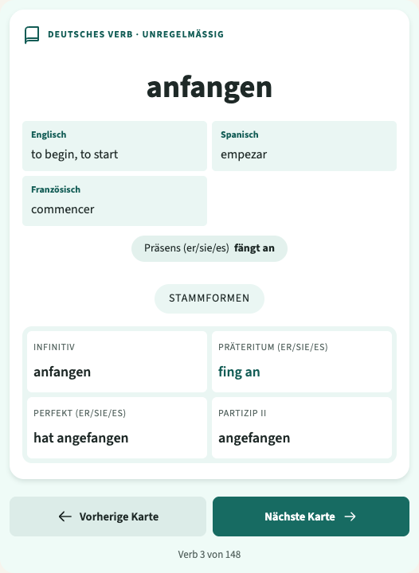

# hello.profe

**A language-learning companion built from a real need: studying German while living in a multilingual family.**

Practise irregular German verbs, study their forms with flashcards, and translate short Spanish texts into German. Built with React, TypeScript and a Cloudflare Worker API.

[Try the demo](https://ccisternas-dev.github.io/hello.profe/) · [Explore the code](src/) · [LinkedIn](https://www.linkedin.com/in/ccisternasv/) · [GitHub profile](https://github.com/ccisternas-dev)

[](docs/images/verb-flashcards.png)

## Why I built it

Living in Brussels with a multilingual family means switching between languages every day. As a Spanish speaker learning German, I wanted a focused way to practise verb forms and understand everyday text.

hello.profe is my personal portfolio project, extending my experience building WordPress websites into React, TypeScript, API integration and data modelling. It brings product decisions, interface design, frontend development and a small backend together around something I use for my own learning.

“Profe” is an informal Spanish word for a teacher. The name reflects the approachable learning experience I want to create.

## What you can try

| Feature | Available today |
| --- | --- |
| **Translation Challenge** | Recall German verb forms from English, Spanish or French prompts, with single-form and mixed modes. |
| **Complete the Verb** | Practise supplied forms one field at a time, with hints, answer checking and a session summary. |
| **Flashcards** | Browse 148 irregular German verbs, their translations, present tense and principal forms. |
| **Spanish → German translation** | Translate short text through a separate Worker API, with input limits and error handling. |
| **Five interface languages** | English, French, Dutch, German and Spanish; changing the interface language preserves the active study session. |

**Try this:** open Practice, choose Translation Challenge, then check an answer or use a hint. Open Flashcards to compare the same learning material in a reading-focused format.

The practice engine uses bundled data rather than AI-generated answers. Translation is a separate online feature and is subject to service availability and request limits. Interface-language support does not imply translation support for every language pair.

## Engineering highlights

- **Explicit learning state.** A typed reducer manages answers, hints, scoring and review scheduling. Tests cover stale submissions and session transitions. [Challenge engine](src/verb-challenge.ts) · [Rules and validation](docs/verb-challenges.md)
- **Traceable data conversion.** A Python standard-library pipeline converts supplied workbooks into structured JSON, retaining source references and rejecting missing answers or duplicate identities. The source dataset contains 917 cards across nine decks; the current verb interface exposes 148 verbs and 740 supplied form targets. Structural validation is distinct from independent linguistic verification. [Data pipeline](scripts/convert_practice.py) · [Data audit](docs/practice-data-audit.json)
- **A bounded translation API.** The Worker validates input, applies request limits and maps provider failures to safe responses. A provider adapter keeps model-specific handling separate from the endpoint. [Request handler](worker/src/index.ts) · [Provider adapter](worker/src/provider.ts)
- **Reusable interface foundations.** Semantic color and spacing tokens, shared components, visible keyboard focus and responsive navigation support the learning screens. Flashcards provide the visual reference for the learning interface. [Components](src/components.tsx) · [Styles](src/index.css)
- **Localization and delivery checks.** Five message catalogs are checked alongside data validation, tests, TypeScript and the production build in GitHub Actions. [Localization guide](docs/internationalization.md) · [CI workflow](.github/workflows/pages.yml)

## Architecture and tradeoffs

| Layer | Implementation | Reason |
| --- | --- | --- |
| Frontend | React 19, TypeScript, Vite | Typed components and state with a static production build. |
| Styling | Shared CSS tokens and components; Tailwind CSS tooling | A consistent visual foundation with responsive layouts. |
| Practice data | Bundled JSON, converted with Python | Study sessions do not depend on a translation service or model output. |
| Translation backend | TypeScript Cloudflare Worker + Workers AI M2M100 | Provider access stays server-side; the adapter isolates model-specific code. |
| Hosting | GitHub Pages frontend, separately deployed Worker | Keep the frontend static and deploy backend changes independently. |
| Verification | Node test runner, TypeScript, data and locale checks | Check learning rules, API behavior and content structure with repository tooling. |

The public translation path is browser → Worker → Workers AI. Local translation uses a Vite proxy to attach the private development token server-side. Routine automated tests use mocked provider responses.

Keeping practice local and translation separate makes the core learning flow usable without an API dependency. It does **not** provide offline installation or persistent study progress: those require additional work.

## Scope and next steps

This is a working personal project under active development. Vocabulary exploration and Notebook remain interface prototypes. Practice progress resets when leaving the screen or reloading; the interface-language preference is saved in the browser.

Next areas of work are visual consistency, translation-quality evaluation, sourced vocabulary details and a functional local notebook. Accounts, cross-device sync, offline/PWA support and automatic spaced repetition are not implemented. Translation output can contain mistakes and should be verified for important uses.

## Run locally

Use **Node 22.22.0** and **pnpm 10.34.3**, matching CI.

```sh
git clone https://github.com/ccisternas-dev/hello.profe.git
cd hello.profe
npx --yes pnpm@10.34.3 install --frozen-lockfile
npx --yes pnpm@10.34.3 dev
```

Open `http://localhost:8443`. Practice and Flashcards use bundled data. The ordinary local preview leaves real translation disabled unless an API is configured.

For live local translation, follow the [backend setup guide](docs/translation-backend.md), then run these in separate terminals:

```sh
pnpm worker:dev --var TRANSLATION_ENABLED:true
pnpm dev:translation
```

This requires Cloudflare setup and a private local token. AI inference uses the configured Cloudflare account's allowance; keep credentials out of frontend environment variables and source control.

### Validation

```sh
pnpm i18n:check
pnpm data:validate
pnpm test
pnpm typecheck
pnpm build
pnpm worker:check
```

`worker:check` bundles the Worker in dry-run mode without deploying it. If pnpm is not installed directly, use `npx --yes pnpm@10.34.3` in place of `pnpm`.

### Design system

Run `pnpm dev:design` to browse the developer-only Foundations and Components showcase. It documents colors, typography, spacing, controls and feedback states.

[View foundations](docs/images/design-system-foundations.png) · [View components](docs/images/design-system-components.png) · [Showcase guide](docs/design-system-showcase.md)

### Deployment

The [Pages workflow](.github/workflows/pages.yml) checks pull requests and deploys the frontend from `main`. The Worker is deployed separately; see [backend deployment and rollback](docs/translation-backend.md#deployment).

To preview the GitHub Pages subpath locally:

```sh
GITHUB_PAGES=true pnpm build
pnpm preview --host 127.0.0.1
# Open http://127.0.0.1:8443/hello.profe/
```

Repository maintainers use `GH_CONFIG_DIR="$HOME/.config/gh-personal"` for GitHub CLI and authenticated Git operations in this project.

## Development process and AI assistance

I use Google Stitch for wireframes and inspiration, Figma Make for the logotype and design system, OpenAI Codex for implementation assistance, and GitHub Copilot and Claude for additional review. I review and test the output, and use repository checks to validate behavior.

The project records implementation rules, data provenance and tradeoffs in its documentation. AI assistance is part of the workflow; generated output is not treated as evidence that a feature works or that language content is accurate.

## Further reading

- [Challenge behavior and scoring](docs/verb-challenges.md)
- [Data provenance and conversion](docs/study-release.md)
- [Translation API, evaluation and deployment](docs/translation-backend.md)
- [Localization](docs/internationalization.md)
- [Responsive navigation](docs/navigation.md)
- [Architecture decisions](docs/decisions/)

## Licensing

A code license has not yet been selected; this repository does not grant one. Third-party learning data requires separate source attribution and licensing review before reuse.
