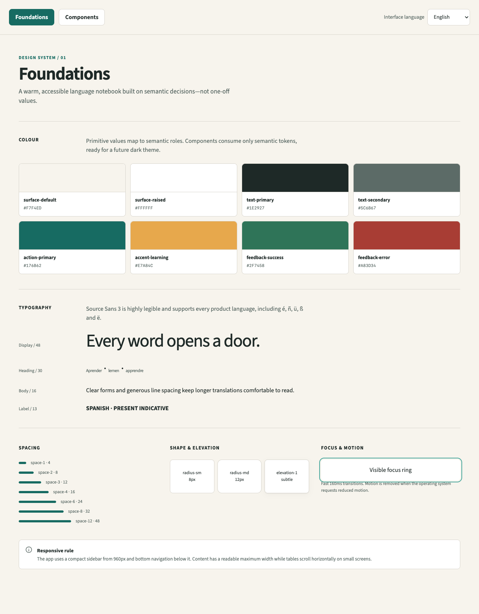
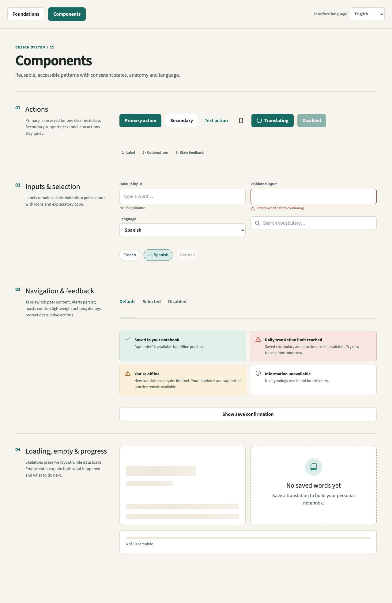

# German study release

The learning dashboard offers three paths: **Translation Challenge**, **Complete the Verb**, and **Flashcards**, with icons and descriptions. Verb challenges support single-form, complete-the-verb and mixed variations for 148 verbs and 740 supplied form targets. Type German answers to English, Spanish or French prompts, retry mistakes, use hints and review missed forms. No translation API is used. See [challenge rules and validation](docs/verb-challenges.md).

**Flashcards** uses **917 cards in nine decks** from the supplied B2 Excel workbooks: 592 verb-form cards, 140 health cards, 101 friendship cards, 28 temporal connector cards and 56 exercises across five exercise decks. It opens without saving a notebook word.

Reveal answers, navigate, shuffle, mark Again/Remembered, and repeat the Again queue. Flashcard results are self-assessments; challenge answers use explicit accepted forms. Progress is session-only; leaving Practice or reloading resets it. Translation, exploration and notebook screens remain labelled interface prototypes. Offline support, accounts, saved progress and automatic spaced repetition are not implemented.

## Interface languages

Use the language selector for English, French, Dutch, German or Spanish. The choice is remembered on this device, and switching languages preserves the active study session. Learning content retains its original language. See [internationalization](docs/internationalization.md) for translation maintenance and checks.

## Design system showcase

The design system stays in the codebase as a developer showcase. Public desktop and mobile navigation is reserved for the learning interface.

[](docs/images/design-system-foundations.png)

[](docs/images/design-system-components.png)

Click either screenshot to inspect it at full size. To explore the interactive showcase locally, run:

```sh
npx --yes pnpm@10.34.3 dev:design
```

This opens `http://localhost:8443/?design-system=foundations`. Switch to Components with the showcase navigation, or open `http://localhost:8443/?design-system=components` directly. The preview supports all five interface languages. It is enabled only by the development server; production builds always open the learning app.

The views live in [src/DesignSystem.tsx](src/DesignSystem.tsx), reusable components in [src/components.tsx](src/components.tsx), and tokens/styles in [src/index.css](src/index.css). After design changes, regenerate both screenshots following [the showcase guide](docs/design-system-showcase.md).

## Run and verify

Use Node 22.22.0 and pnpm 10.34.3 (CI pins both):

```sh
npx --yes pnpm@10.34.3 install --frozen-lockfile
npx --yes pnpm@10.34.3 i18n:check
npx --yes pnpm@10.34.3 data:validate
npx --yes pnpm@10.34.3 test
npx --yes pnpm@10.34.3 typecheck
npx --yes pnpm@10.34.3 dev
```

Regenerate JSON with `python3 scripts/convert_practice.py` after placing the three original `.xlsx` files in `practice/`. Python 3 standard-library tools read workbook relationships, shared/inline strings and sparse cells. Raw workbooks remain local and are not bundled or published. See [data notes](docs/study-release.md) and [row/card counts](docs/practice-data-audit.json).

## GitHub Pages

The workflow checks pull requests and builds/deploys `main`. Set Settings → Pages → Source to GitHub Actions. `GITHUB_PAGES=true` selects `/hello.profe/` independently of Figma preview configuration. Navigation stays on one page; no server routing is needed.

Expected deployment address: https://ccisternas-dev.github.io/hello.profe/ (deployment verification is recorded below when available).

To preview the production subpath locally:

```sh
GITHUB_PAGES=true npx --yes pnpm@10.34.3 build
npx --yes pnpm@10.34.3 preview --host 127.0.0.1
# Open http://127.0.0.1:8443/hello.profe/
```

Personal GitHub operations use `GH_CONFIG_DIR="$HOME/.config/gh-personal"`; this repository already sets the personal commit email locally. Global identity/settings are unchanged.

---

# hello.profe

Translate, explore words, and practise verb conjugations across five languages.

**Status: planning.** This README describes the intended product. The broader product remains in development; see the study release status above.

## About

hello.profe is a personal language-learning companion for Spanish, German, English, French and Dutch. It brings short-text translation, vocabulary exploration and verb practice into one workflow:

**Translate → explore → save → practise.**

The project is also a developer portfolio project. It builds on my experience developing WordPress websites while I explore React, TypeScript and application development, including API integration, data modelling and testing.

## Personal inspiration

Since moving abroad and building a multilingual family, switching between languages has become part of my everyday life. I did not grow up speaking several languages, so learning them has taken—and still takes—a lot of time, effort and practice. hello.profe grows out of that experience: I want to build a companion for the moments when I need to find a word, understand how it works or practise until it feels more familiar. It brings together two things I keep learning: languages and web development.

Spanish is my native language, and I keep learning English, French and German. I also want to pass Spanish on to my children while raising them in Brussels, where French and Dutch are part of our surroundings.

## Current delivery priorities

The long-term goal remains simultaneous multilingual translation with vocabulary exploration and practice across all five languages. The first translation release will focus on Spanish, French, German and English; Dutch remains in the roadmap.

My immediate learning need is German at B1 level, particularly vocabulary about **Freundschaft** and **Gesundheit** and verb forms required for my test. A small practice module using checked local content can support that need while the translation interface develops. Its exact tense coverage will follow the course requirements: Präsens, Perfekt and Plusquamperfekt are distinct, and Partizip II is a verb form rather than a tense.

This changes the order of implementation, not the product's multilingual purpose. Exam practice should stay small enough to support study rather than delay it; it does not require accounts, a translation API or a complete dictionary pipeline.

## Why hello.profe?

“Profe” is a warm, informal way to address a teacher in Spanish, used regardless of the teacher's gender. For me, it also evokes a tutor or mentor: someone approachable who adapts to the learner. Paired with “hello,” it reflects the welcoming, personal spirit I want the app to have.

## Who it is for

Language learners who want to compare vocabulary across languages, understand how a word behaves and practise using it. The focus is individual words, sentences and short paragraphs rather than document translation.

Example journeys:

- Translate a short French sentence into English, German and Dutch in one action.
- Explore a German noun's meaning, article, gender and available synonyms.
- Save a Spanish verb and practise its present-tense forms later.

## Planned features

The broader features below are planned; the static practice release described above is implemented.

| Area | Initial scope |
| --- | --- |
| Translation | Explicit source language; one or several target languages; proposed 1,000-character limit |
| Word exploration | Lemma, part of speech, meanings, article/gender where relevant, available synonyms and source attribution |
| Conjugations | A documented selection of common verbs and present-tense forms, expanded after data validation |
| Vocabulary notebook | Save words and personal examples; filter by language; export/import JSON |
| Practice | Select language and tense; type a conjugated form; receive feedback; revisit mistakes |
| Device support | Responsive web interface, followed by PWA installation on compatible Android and Mac browsers |
| Offline access | Saved vocabulary and bundled practice data; new translations require internet |

Language coverage will be published explicitly. A missing dictionary field will be shown as unavailable rather than inferred. General language support does not imply complete conjugation or synonym coverage.

## Product principles

- **Context matters.** Separate meanings and allow an optional example sentence for ambiguous vocabulary.
- **Grammar needs evidence.** Use checked lexical data for gender and conjugation answers. Label any future generated explanations separately.
- **Failure is part of the interface.** Show per-language errors and allow retries without discarding successful results.
- **Keep the budget controlled.** Target free hosting and limited free inference; stop gracefully when quotas are reached.
- **Keep personal learning data local initially.** No account or automatic cross-device sync in the first release. Export/import provides manual transfer.
- **Design for access.** Support keyboards, clear focus states, readable feedback and small screens.

## Proposed architecture

| Layer | Proposed technology | Purpose |
| --- | --- | --- |
| Frontend | React, TypeScript, Vite | Application interface and typed state |
| Styling | CSS / CSS Modules | Responsive, accessible presentation |
| Backend | Cloudflare Worker in TypeScript | Validate inputs, enforce quotas and call providers |
| Hosting | Cloudflare Workers Static Assets | Serve frontend and API from one origin |
| Translation | Provider adapter; evaluate Workers AI M2M100 first | Keep provider choice replaceable and evidence-based |
| Lexical data | Curated Wiktionary/Kaikki subset, subject to audit | Sourced vocabulary and conjugation information |
| Storage | IndexedDB | Vocabulary and practice history on each device |
| Offline / installation | Web app manifest and service worker | Installable interface and offline learning assets |
| Testing | Vitest, React Testing Library; selected Playwright flows | Verify answer checking, interactions and critical journeys |
| Planning | GitHub Issues, Projects and pull requests | Track decisions, implementation and verification |

The translation provider and data pipeline remain open decisions until feasibility testing is complete. Translation and lexical lookup are separate services. API credentials stay server-side; browser bundles must never contain secrets.

## Scope boundaries

The initial release excludes document uploads, OCR, speech recognition, native Android/macOS packages, accounts, automatic cloud sync, complete tense coverage and advanced spaced repetition. The interface supports English, French, Dutch, German and Spanish; translation-language support is separate from interface localisation.

## Roadmap

- [ ] Validate translation quality, free-plan access and grammar-data coverage.
- [ ] Release a short-text translation prototype with multiple targets.
- [ ] Add sourced word details and a local vocabulary notebook.
- [ ] Add a small, reliable conjugation practice loop.
- [ ] Add PWA behaviour and verify Android/Mac use.
- [ ] Publish the portfolio case study and document remaining limitations.

See [issues.md](issues.md) for the current release plan.

## Development status

A runnable frontend prototype is now scaffolded with React, TypeScript and Vite, with views for translation, word exploration, the vocabulary notebook and practice, alongside design-system foundations and reusable components. These screens demonstrate the interface; the full product features remain in development. The component errors have been fixed, and TypeScript validation (`pnpm exec tsc --noEmit`) and the production build (`pnpm build`) pass. Run `pnpm dev` to start the local development server. Installation from a clean checkout and a live deployment have not yet been verified.

## Quality, privacy and cost

Translations can be inaccurate, especially for isolated words. The evaluation will cover all 20 directions between the five languages and include ambiguous vocabulary, irregular verbs and short paragraphs.

Saved learning data is intended to stay on the device initially. Text submitted for translation will be sent to the configured provider through the backend. Before launch, document that provider's data handling, avoid logging raw input and provide controls to clear local data. Browser data may be cleared or evicted; exports are the user's backup.

The operating-cost target is €0 within free allowances, not unlimited free service. Recheck provider terms and quotas before deployment. A custom domain is optional; the project name does not imply ownership of hello.profe.

## Development process and AI assistance

I use the free version of Figma Make to develop the logotype and design system. This is part of exploring how AI-assisted design can support the project within a limited budget.

Important decisions will record the problem, options, evidence, choice and consequences in `docs/decisions/`. Issues will contain acceptance criteria; pull requests will explain changes and validation.

AI assistance, when used, will be documented honestly where relevant. Generated code and language content require review and appropriate verification. Claims of quality will be supported by examples or measured results.

## Licensing and attribution

A code licence has not been selected yet; this README does not grant one. Before publishing reusable dictionary data, document the exact dataset versions, sources, attribution and applicable licence obligations. Code licensing and third-party data licensing must be tracked separately.

## Reference documentation

- [React](https://react.dev/learn)
- [TypeScript](https://www.typescriptlang.org/docs/)
- [Vite](https://vite.dev/guide/)
- [Cloudflare React + Vite](https://developers.cloudflare.com/workers/framework-guides/web-apps/react/)
- [Cloudflare Workers AI pricing](https://developers.cloudflare.com/workers-ai/platform/pricing/)
- [Kaikki machine-readable dictionaries](https://kaikki.org/dictionary/index.html)
